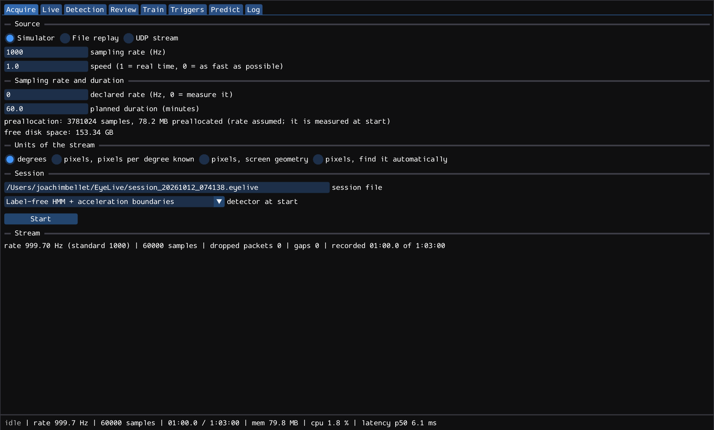
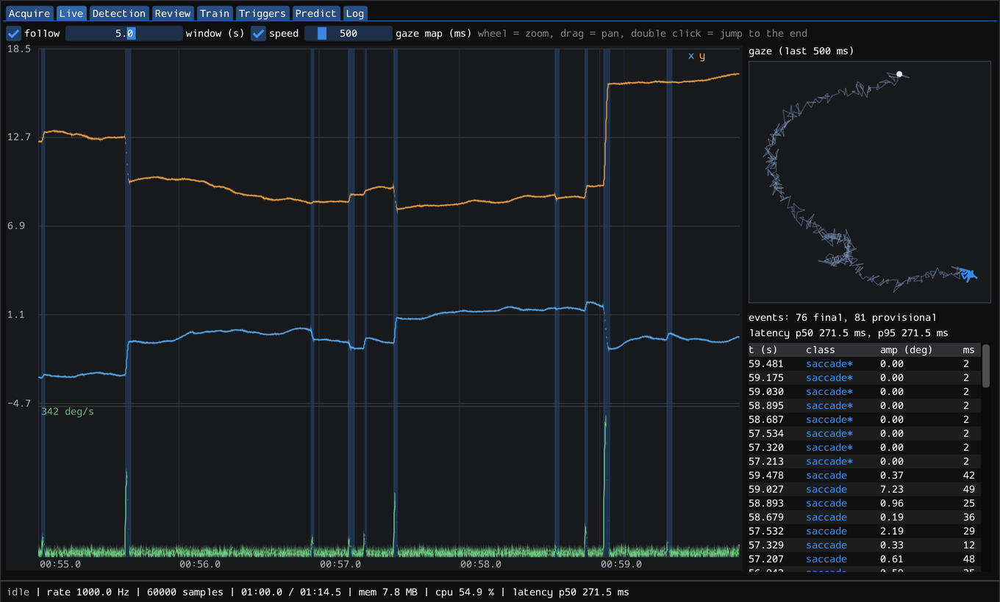
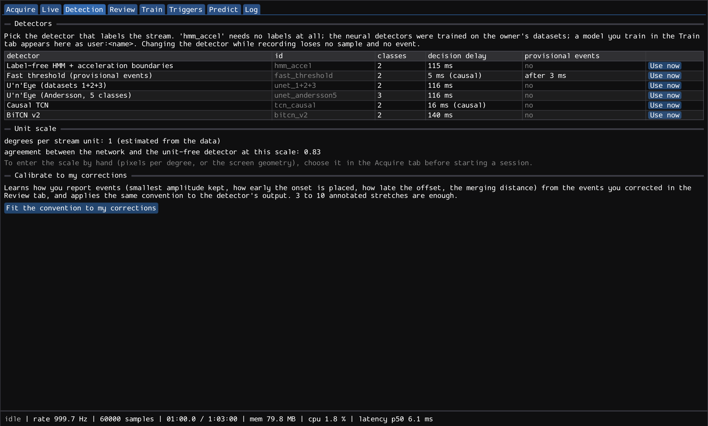
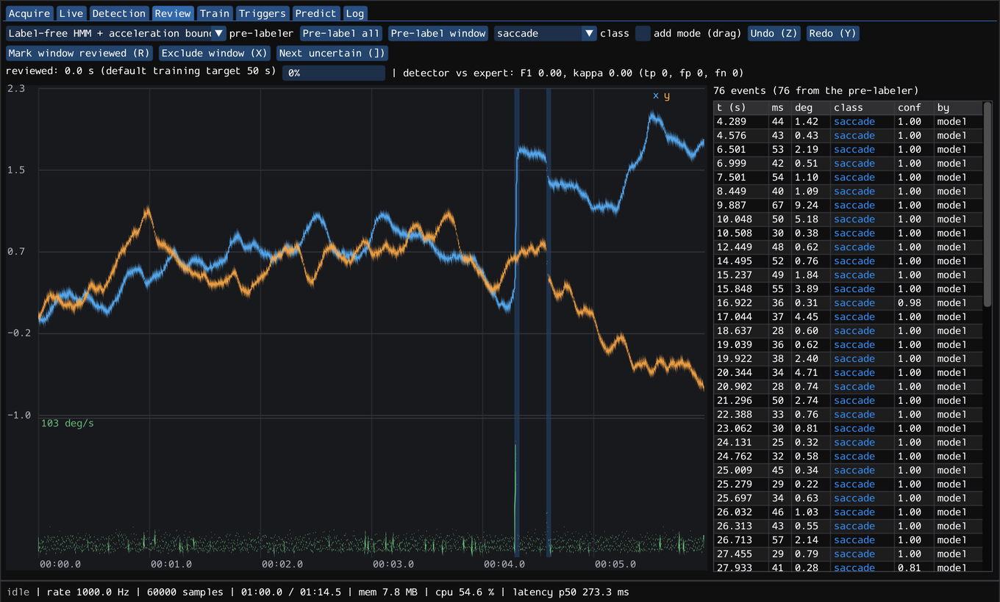
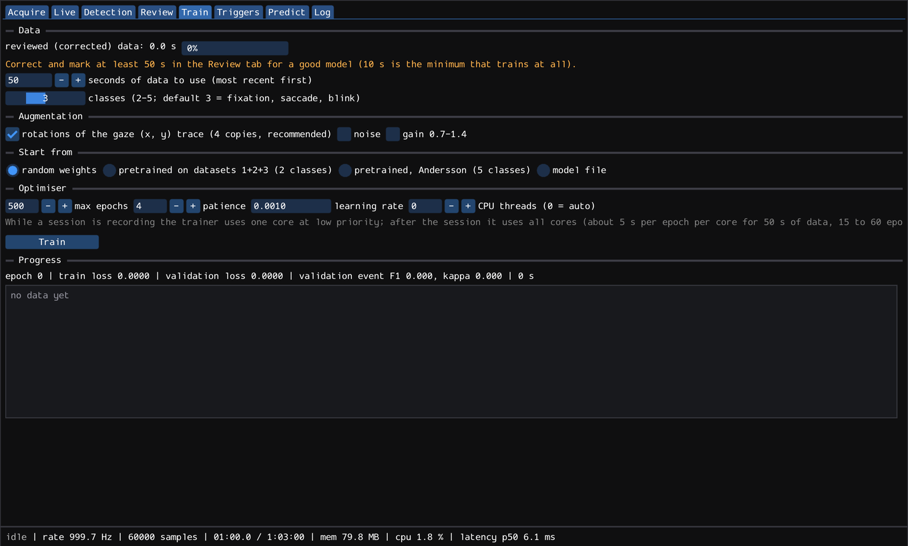
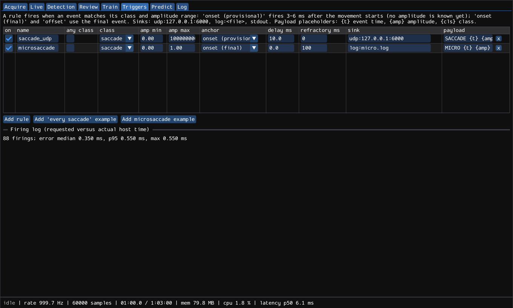
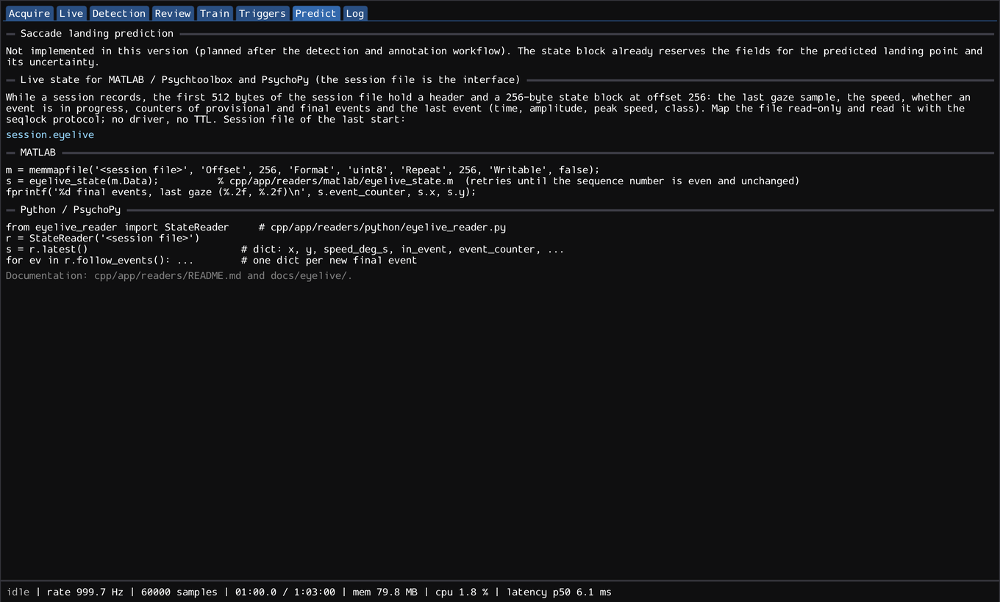

# EyeLive user manual

EyeLive records an eye-tracker stream in real time, labels saccades (and blinks) automatically, lets you correct the labels in a few minutes, learns from your corrections, and can trigger your experiment on events. It is one small program (a window, plus a command-line twin `eyelive_cli`), without installer and without administrator rights. (Version française : [MANUAL_FR.md](MANUAL_FR.md).)

## 1. Install
Unzip the release into a folder you own and follow [INSTALL_UNSIGNED.md](INSTALL_UNSIGNED.md) (also in the zip as `INSTALL.txt`): check the SHA-256, unblock the zip on Windows, "Open Anyway" on macOS, add the folder as an antivirus exclusion if needed. The zip contains `eyelive` (window), `eyelive_cli` (no window) and `models/` (pretrained networks: keep the folder next to the program).

## 2. What the program does with your data
* A **session file** (`.eyelive`) is created when you press Start in the size you announce (preallocated: it cannot fill the disk during the experiment). It holds the samples, the detected events, your corrections and a small real-time **state block** that MATLAB/Psychtoolbox or Python/PsychoPy can read while recording (section 9).
* Nothing leaves the computer. UDP is opened only while a session records.
* Three classes by default: **fixation** (smooth pursuit stays in it), **saccade** (post-saccadic oscillations stay in it), **blink**. You can use up to five.

## 3. First session: the Acquire tab

1. **Source.** *Simulator* (no tracker needed: try everything with it), *File replay* (a CSV `t,x,y[,valid]`), or *UDP stream* (the tracker computer sends the samples to a port; section 3.1).
2. **Sampling rate and duration.** Leave the rate at 0 and EyeLive measures it from the first 500 ms and snaps it to the nearest standard rate (60, 120, 250, 300, 500, 1000, 1200, 2000 Hz). The planned duration sets the preallocation, shown as you type, with the free disk space.
3. **Units of the stream.** *Degrees*; *pixels with a known pixels-per-degree*; *pixels with the screen geometry* (screen width in cm, viewing distance in cm, horizontal resolution: the program computes pixels per degree); or *find it automatically* (section 8).
4. **Session file** and **detector at start** (the default `hmm_accel` needs no labels). Press **Start**; an error (port already used, directory missing, not enough space) is written next to the button. **Stop** closes the file cleanly.

### 3.1 Sending samples (protocol v1)
UDP datagrams to the port, little endian. Binary: `uint32 0x31455945 ("EYE1")`, `uint32 n`, then `n` records of `double t_seconds, float x, float y, uint32 flags` (20 bytes; flags 1 = valid, 2 = blink). Text: one sample per line, `t x y [valid]`. 1 to 50 samples per datagram. `cpp/app/tools/send_udp.py` replays a CSV in this format; `cpp/app/tools/pylink_sender_template.py` is a template to forward EyeLink samples (untested template).

## 4. Watching the stream: the Live tab

x and y position (blue, orange), speed (green) and the events as coloured bands; the gaze map shows the last 500 ms. Wheel = zoom, drag = pan, double click = jump to the end, *follow* keeps the newest data in view. The right-hand table lists the latest events. The status bar shows the measured rate, memory, CPU and the detection latency.

## 5. Detectors: the Detection tab

`hmm_accel` (label-free, boundaries refined by the acceleration zero: use it first), `fast_threshold` (fastest: an event 3-6 ms after the onset, for triggers), the pretrained U'n'Eye networks, the causal and bidirectional TCNs, and the models you train yourself (`user:<name>`). **Use now** swaps the detector during the recording without losing a sample or an event. **Fit the convention to my corrections** learns how you place onsets and offsets and which amplitudes you keep.

## 6. Correcting the labels: the Review tab

1. Choose the **pre-labeler** and press *Pre-label all* (or *window*): the detector's events appear as bands and in the list.
2. Correct: **click** an event to select it; **drag its edges** to move the onset or the offset; in **add mode**, drag across the plot to create an event; **Delete** removes it; keys **1-4** set its class; **S** splits it at the cursor; **M** merges it with the next one; **Z / Y** undo / redo.
3. Press **R** (or *Mark window reviewed*) for every stretch you checked; **X** excludes a stretch you do not want to train on. *Next uncertain* (**]**) jumps to the events the detector was least sure about.
4. The bar shows the reviewed seconds against the 50 s default target; the agreement line compares the detector with your corrections (event F1 and kappa).

## 7. Learning from your corrections: the Train tab

Defaults: 3 classes, the most recent 50 s of reviewed data, rotations of the gaze trace on (4 copies; switch off if your task is strongly direction-specific), start from random weights (or from a pretrained network, which helps on small datasets). **Train** runs in the background (one core at low priority while a session records, all cores afterwards; about 5 s per epoch per core for 50 s of data). The curves show training and validation loss and the validation event F1. **Deploy as detector** saves the model next to the session and adds `user:<name>` to the detectors. You can raise the amount of data at any time and train again.

## 8. Units and the scale
EyeLive's networks work in degrees. If the stream is in pixels, either give the pixels per degree (best) or let EyeLive estimate it: it compares the network at many scales with the unit-free detector and keeps the scale where they agree (the Log tab shows it; a warning says when the confidence is low, then enter the value). An approximate scale is enough for detection; amplitudes in degrees are only as good as the scale.

## 9. Triggers and real-time output: the Triggers and Predict tabs

A rule fires on an event of a class (or any), optionally within an amplitude range, **after a delay**, and sends a UDP message (`udp:127.0.0.1:6000`), writes a log line (`log:<file>`) or prints (`stdout`). Anchors: *onset (provisional)* fires 3-6 ms after the movement starts (the amplitude is not known yet: it cannot be combined with an amplitude range), *onset (final)* and *offset* use the final event. Payload placeholders: `{t}` event time, `{amp}` amplitude in degrees, `{cls}` class. The Log tab lists the requested and the actual firing times.


No TTL hardware is needed: your stimulus program reads the **state block** of the session file (last gaze, speed, event counters, last event). MATLAB / Psychtoolbox: `m = memmapfile(session, 'Offset', 256, 'Format', 'uint8', 'Repeat', 256);` then `eyelive_state(m.Data)` (`cpp/app/readers/matlab/`). Python / PsychoPy: `from eyelive_reader import StateReader` (`cpp/app/readers/python/`). Landing-point prediction is not implemented in this version.

## 10. Without the window: eyelive_cli
```sh
eyelive_cli --sim --duration 5 --session demo.eyelive
eyelive_cli --udp 5005 --duration 3600 --session subject1.eyelive --scale auto
eyelive_cli --sim --duration 20 --prelabel-seconds 15 --train --session train.eyelive
```
See `CLI.txt` (cpp/app/cli/README.md): replay, trigger rules file, events CSV, exit codes. `docs/eyelive/check_commands.sh` runs the commands of this manual.

## 11. Troubleshooting
| symptom | what to do |
|---|---|
| Windows or macOS refuses to start the program | [INSTALL_UNSIGNED.md](INSTALL_UNSIGNED.md): unblock, Open Anyway, antivirus exclusion |
| Windows Firewall asks about network access | choose *Private networks*; not needed when the tracker computer is the same machine (127.0.0.1) |
| Start fails: "cannot create ...: File exists" | a session file is never overwritten: pick a new name |
| Start fails: "no samples received to measure the sampling rate" | nothing arrives on the port: check the address, the port and the sender; declare the rate to skip the measurement |
| dropped packets / gaps in the status bar | the sender is faster than the network or the PC: send 5-20 samples per datagram, close heavy programs |
| "automatic unit scale has low confidence" | enter the pixels per degree or the screen geometry in the Acquire tab |
| nothing is detected | check the units (a stream in pixels read as degrees is too small); try another detector; look at the Live tab |
| the window does not open (Linux) | OpenGL 3.2 is required: `glxinfo | grep "OpenGL version"` |
| the session is huge | the file is preallocated for the planned duration: lower it; it is a plain binary file you can copy |
